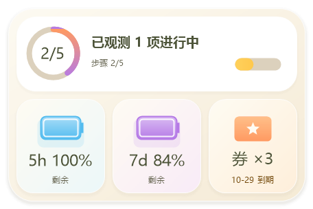

<p align="center">
  
</p>

# Codex DX HUD for Windows

[简体中文](README.zh-CN.md) · [繁體中文](README.zh-TW.md) · **English**

A lightweight Windows tray app for Codex quota, reset times and reset credits, with desktop and window-attached overlays.

> Unofficial community project, not affiliated with OpenAI. Uses the experimental local `codex app-server` protocol.

## Original project and derivative notice

This repository is a derivative work based on the original [D1NOOO/codex-usage-monitor](https://github.com/D1NOOO/codex-usage-monitor) project. The original project is licensed under the [MIT License](https://github.com/D1NOOO/codex-usage-monitor/blob/main/LICENSE); this repository keeps that license and the original attribution. The `daxian-w/codex-dx-hud` repository adds the glass HUD, hover expansion, size and skin options, task-status handling, reset-time display, unified settings/tray styling, diagnostics and regression tests. See the full [open-source release notes](docs/OPEN-SOURCE-RELEASE.md).

## Features

- **Usage at a glance**: 5-hour and 7-day quotas, remaining or used percentages, and Auto / Show all / Weekly usage only panels.
- **Flexible overlays**: Draggable, always-on-top desktop mode or click-through window attachment; single-row and multi-row layouts.
- **Automatic fullscreen adaptation**: The desktop overlay hides during fullscreen on the same monitor and returns to its position afterward. Normal maximized windows stay unaffected, and usage monitoring continues in the background.
- **Reset credits**: Available count and earliest expiry, queried read-only. Credits are never redeemed.
- **Everyday convenience**: Live appearance preview, three UI languages, start with Windows and verified in-place updates.

## Glass widget preview (0.4.0)

The new cream-glass widget expands on hover and has five sizes, with Compact selected by default. The original desktop strip and click-through attachment remain available. Settings, menus and the update dialog share the new theme.

Task status uses a partial, read-only view of structured local Codex Desktop activity. Unknown data is not displayed as zero; this build does not invent plan progress. Windows 11 and real pointer validation are still pending. See the [guide](docs/orb-guide.md), [capability report](docs/capability-report.md) and [acceptance status](docs/orb-acceptance-report.md) (Chinese).




## Install and use

Requires Windows 10/11 with .NET Framework 4.8 and a ChatGPT-account login through ChatGPT desktop, Codex App or Codex CLI. API-key login does not provide subscription quotas.

1. Download `CodexRateMonitor-VERSION-windows-x64.zip` from [Releases](https://github.com/daxian-w/codex-dx-hud/releases). Use `SHA256SUMS.txt` to verify the archive.
2. Extract to a stable folder and run `CodexRateMonitor.exe`.
3. Right-click the tray icon for commands, or double-click it for appearance settings. Check the `^` overflow if the icon is hidden.

Release executables are unsigned; Windows SmartScreen may display an unknown-publisher prompt.

## Screenshots

### Appearance settings

Customize layout, fonts, colors, opacity and 50%–200% scale with a live preview. Choose Auto, Show all or Weekly usage only; preview values are sample data.


### Overlay layouts

Single row:


Multiple rows:


Credit expiry turns warning-colored within 7 days and danger-colored within 3 days. The credit card hides when no credits are available.

### Tray summary

Hover over the tray icon for usage, update time and credit details.


## Refresh behavior

| Desktop app state | Default interval |
|---|---|
| Foreground | 30 seconds |
| Visible in background | 60 seconds |
| Minimized, hidden or not running | 300 seconds |
| Reset-credit query | 30 minutes |

The monitor reuses one app-server connection and supplements polling with quota notifications. Returning to the foreground, restoring the window or waking Windows schedules a refresh. Failed reads retain cached data and retry with backoff; invalid login clears old quotas.

Data can briefly differ from the official UI. Total app-server traffic includes its own background requests. See [refresh and diagnostics](docs/usage-refresh.md) for details.

## Configuration

Most options are available in appearance settings. See the [default settings](https://github.com/daxian-w/codex-dx-hud/blob/main/config/settings.default.json) for all fields.

| Field | Values / default |
|---|---|
| `Language` | `auto` / `zh-CN` / `zh-TW` / `en` |
| `OverlayMode` | `desktop` (default) / `attach` |
| `UsageDisplay` | `remaining` (default) / `used` |
| `UsagePanels` | `auto` (default) / `all` / `weekly` |
| `DisplayLines` | `1` / `2`; bottom-right attachment defaults to `2`, with manual override |
| `ShowResetCredits` | `true` by default |
| `ForegroundRefreshSeconds` | 30 to `RefreshSeconds` seconds; default 30 |
| `RefreshSeconds` | 30–900 seconds; default 60 |
| `MinimizedRefreshSeconds` | 60–3600 seconds; default 300 |
| `ResetCreditsSeconds` | 300–86400 seconds; default 1800 |
| `DiagnosticsEnabled` | `false` by default |

Overlay scale is 50%–200%, applied in addition to Windows display scaling. Updates preserve `settings.json`; older scale settings are converted once to retain the same displayed size.

## Data and privacy

Usage is read through the local `codex app-server`; ChatGPT/Codex manages sign-in and token refresh. Reset-credit queries separately read the local `~/.codex/auth.json` access token for the read-only `chatgpt.com/backend-api/wham/rate-limit-reset-credits` endpoint. The token is held only during the request and is never stored by the monitor.

Diagnostics are off by default. When enabled, redacted logs in `%LOCALAPPDATA%\CodexRateMonitor\logs` retain 7 days (configurable from 1–30) within a 20 MiB budget. Report vulnerabilities privately as described in [SECURITY.md](SECURITY.md).

## Troubleshooting

| Problem | Action |
|---|---|
| Codex executable not found | Open or update ChatGPT desktop, or check the CLI installation with `codex --version`. |
| No quota data / login expired | Sign in with a ChatGPT account, then choose **Refresh now** from the tray menu. |
| Overlay missing or misplaced | Confirm the monitor is running and the attached app window is visible; adjust placement in appearance settings. |

If the problem persists, [open an issue](https://github.com/daxian-w/codex-dx-hud/issues) with a screenshot that excludes private information.

## Build and release

```powershell
git clone https://github.com/daxian-w/codex-dx-hud.git
cd codex-dx-hud
.\scripts\verify.ps1
.\scripts\build.ps1 -Package
```

Output is written to `artifacts/`. For a release, update `version.txt`, prepare concise Chinese-first bilingual notes, complete their review, then push the matching tag. The Release workflow builds, tests and publishes the archive with provenance.

## License

[MIT](LICENSE).
